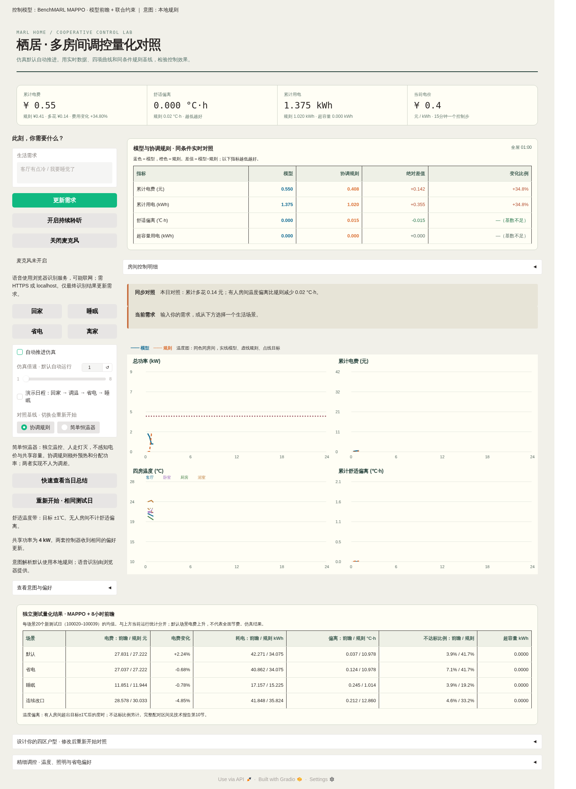
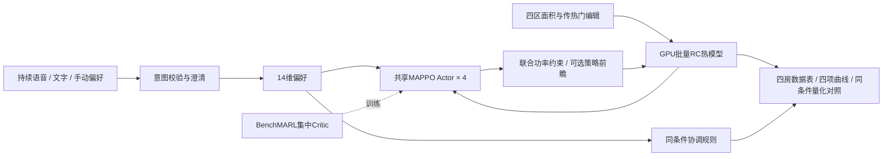

# 栖居 MARL Home

基于 **BenchMARL + TorchRL 的多房间协同控制实验平台**。四个房间各有一个 agent，学习在共享 4 kW 软容量约束下协调供暖与照明。住户修改生活需求，语言层更新偏好，策略决定设备动作。

现已替换 EPyMARL/QMIX 主线。新增功率约束分配与基于热模型的 MAPPO 策略前瞻，见 [架构优化复验](docs/架构优化复验.md)。项目重点是可复现的控制实验、物理有效的四区户型编辑和同步对照展示。效果数字见 [技术报告](docs/技术报告.md)，不预设“节电 15%”。

## 阅读入口与主要结果

- **[正式技术报告](docs/技术报告.md)**（[PDF下载](docs/技术报告.pdf) · [独立HTML](docs/技术报告.html)）：问题建模、算法、完整实验、消融、统计口径及局限。
- [实验索引](docs/实验索引.md) · [完整指标CSV与数据字典](assets/tables/README.md) · [模型/数据校验清单](assets/evidence/manifest.json)
- [复现指南](docs/复现指南.md)：从克隆到启动、评估、训练和验收。

仓库附带七组验证选中的模型权重、训练配置和真实评估数据，启动演示不必重新训练。主要结果来自**冻结架构后的20个新测试日/场景**；下表比较“MAPPO + 8小时前瞻”与未削弱的协调规则：

|场景|电费变化|舒适偏离变化|电费差95%配对区间/元|
|---|---:|---:|---|
|默认|+2.24%|−99.66%|[−0.169, 1.312]|
|省电|−0.68%|−98.87%|[−1.083, 0.637]|
|睡眠|−0.78%|−75.85%|[−0.326, 0.109]|
|连续改口|−4.85%|−98.35%|[−1.983, −0.920]|

舒适偏离是有人房间超出目标±1℃后的累计度时。只有连续改口的电费差区间完全低于零；其余场景不能据此证明节费。该混合架构使用集中约束执行及已知模型前瞻，不能把全部收益归因于纯MAPPO。耗电量、违规率、超容量和纯策略结果均见报告。





## 安装与启动

建议已有匹配显卡驱动的 CUDA PyTorch，Python 3.11–3.13。本机实测 Python 3.13、PyTorch 2.14.0+cu130；不是所有组合都已验证。

```bash
git clone https://github.com/AnXMuy/MARL-XJTU.git
cd MARL-XJTU
python -m venv --system-site-packages .venv
source .venv/bin/activate
bash setup.sh
pytest -q
python demo/app.py --checkpoint results/layout/mappo42/best_actor.pt --controller lookahead --horizon 32 --port 7861
```

浏览器打开 `http://localhost:7861`。远程访问可用 SSH 转发：

```bash
ssh -L 7861:127.0.0.1:7861 USER@SERVER
```

默认仅监听本机。持续麦克风需要用户点击开启并允许权限，使用 Chrome/Edge 的浏览器识别服务，可能联网；HTTPS 或 localhost 才能可靠使用麦克风。无浏览器识别能力时保留文字输入，**未把模拟语音算作真实语音验收**。

不提供 checkpoint 时页面会明确显示“协调规则”，不会冒充 MARL。可选本地语言模型：`--llm-url http://localhost:8002/v1`；失败时关键词兜底。`deploy/` 和语音服务 client 为可选集成，当前主 Demo 的持续语音不依赖三个 vLLM 服务。旧的显存分配估算不再作为已验证部署承诺。

## 训练

```bash
python -m experiments.v2.bench_train --algorithm mappo --steps 20000000 --envs 1024 --seed 42 --output results/layout/mappo42
# 分别改 seed/output 为43、44重复；公平算法对照：
python -m experiments.v2.bench_train --algorithm ippo --steps 20000000 --envs 1024 --seed 42 --output results/layout/ippo42
```

实际使用 BenchMARL Experiment、TorchRL EnvBase/collector 和 PPO loss。环境物理仿真在 GPU；共享 actor 3×256，critic 3×512。`--hidden`、`--layers`、`--envs` 可调整。每次 reset 随机面积、传热门、天气、日程与偏好；30% 回合在中途换偏好。独立验证集选择 best_actor，测试集不参与选模型。

## 评估与展示素材

```bash
python -m experiments.v2.evaluate \
 --checkpoint mappo42=results/layout/mappo42/best_actor.pt \
 --checkpoint mappo43=results/layout/mappo43/best_actor.pt \
 --checkpoint mappo44=results/layout/mappo44/best_actor.pt \
 --checkpoint ippo42=results/layout/ippo42/best_actor.pt \
 --days 20 --output assets/metrics.json
python -m training.figures
python -m training.verify_export results/layout/mappo42/best_actor.pt
python demo/app.py --checkpoint results/layout/mappo42/best_actor.pt --scripted
```

固定 20 个未见测试种子 × 默认/省电/睡眠/连续改口；比较恒温器、协调规则、MAPPO 三种子和 IPPO。同种子保持天气、人员、户型和偏好一致。指标含电费、能耗、有人时温度偏离、超容量、照明不匹配。bootstrap 是测试日不确定性，训练种子差异另算。

## Demo 操作

1. 在“设计你的四区户型”修改四区面积和传热门，然后应用；两套控制器同时从同一天开始。
2. 开启持续聆听，或输入“客厅有点冷”“我要睡觉了”“省电模式”。识别内容、意图和生效偏好可检查。
3. 页面默认自动推进，可调1–8倍速或开启演示日程；观察温度、舒适偏离、动作和费用的同步对照。可暂停或快速查看当日总结。一天结束循环播放同一测试日并保留用户偏好。
4. 展开精细调控，分别设定四个房间的温度/照明和全局省电权重。新的目标作用于下一控制步。

这里的“户型”是四个固定功能区、每区16–36㎡的参数化模型，传热门是热连接图；不是任意CAD几何或任意房间数。仅冬季供暖；空调3档×灯光3档，共8个实际设备通道。门图由用户配置，不是RL门控动作。没有虚构窗帘、通风等尚未建模的执行器。

## 文件结构

- `experiments/v2/`：版本化 v3 环境、TorchRL适配、BenchMARL训练、成对评估（目录名保留，环境版本以 manifest 为准）。
- `demo/`：中控页面、持续语音、意图与可选本地服务客户端。
- `training/`：启动入口、图表和导出一致性校验。
- `assets/`：当前实验指标、图表和展示素材。
- `docs/`：研究依据、技术报告、压缩后的历史记录。
- `results/layout/`：当前模型、验证历史、训练配置及吞吐记录。

## 相关工作与限制

CityLearn提供建筑协调基准；home-llm提供语言模型控家居工程参考。本项目强调偏好理解与学习型控制分离，不宣称首次结合。MAPPO是集中训练、分散执行的PPO，集中critic估计团队状态价值，共享actor按各房观测决策。这里actor也收到聚合家庭状态，不能宣称完全无通信。相比QMIX，策略梯度不受单调价值分解约束，但是否更好仍须实验。

当前结果仅适用于自建RC仿真，容量是软惩罚并非硬安全保证。需在EnergyPlus/Sinergym、真实传感与设备安全控制层上进一步验证。

参考：[BenchMARL](https://github.com/facebookresearch/BenchMARL)、[TorchRL](https://pytorch.org/rl/)、[MAPPO](https://arxiv.org/abs/2103.01955)、[QMIX](https://arxiv.org/abs/1803.11485)、[CityLearn](https://github.com/intelligent-environments-lab/CityLearn)、[home-llm](https://github.com/acon96/home-llm)。

开发验收：`pip install -r requirements-dev.txt && python -m playwright install --with-deps chromium`，启动Demo后运行 `python -m training.browser_check`。当前截图见 `assets/demo/`；其中 `paired_day.mp4` 为旧版户型视图的真实轨迹回放，不代表当前前端；浏览器测试注入语音识别事件，不测试麦克风声学准确率。

## 架构消融与新测试日复验

```bash
python -m training.architecture_study
python -m training.lookahead_study
python -m training.final_study
python -m training.optimization_report
python -m training.video
```

`--controller raw|feasible|lookahead` 明确区分原策略、集中功率分配和模型前瞻。前瞻使用已知天气/人员日程，是集中执行的混合架构，不是纯分散MAPPO。网络扩容30M步同预算对照未证明越大越好。研究过程与无收益结果均纳入技术报告。

当前前端已移除房屋示意图，以四房数据表和四项时序为主：功率、累计电费、四房温度与目标、累计舒适偏离。表格给出房间温度、目标、规则温度、温度带超出量、供暖功率、照明和累计用电。

实时界面使用固定 Canvas 与双缓冲绘图，只更新曲线数据，保留图表节点和固定时间轴，替代逐步生成整张图片；刷新间隔为1.5秒。主表直接并列模型、规则、绝对差值与变化比例（模型减规则，越低越好）。可选择“简单恒温器”或“协调规则”，切换后从相同种子重跑。简单恒温器不感知电价和共享容量，属于较基础的公开定义基线，未为展示效果额外调差；独立测试表仍明确对比协调规则，不随演示选择改写。
