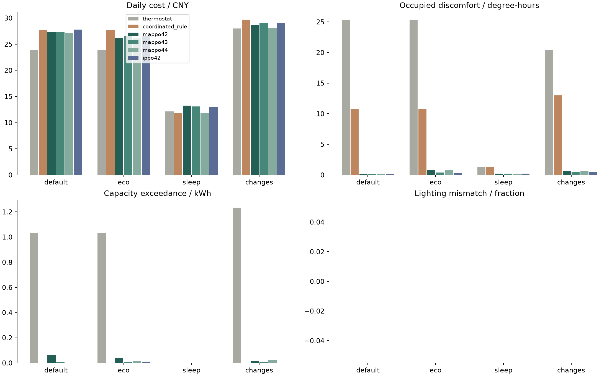
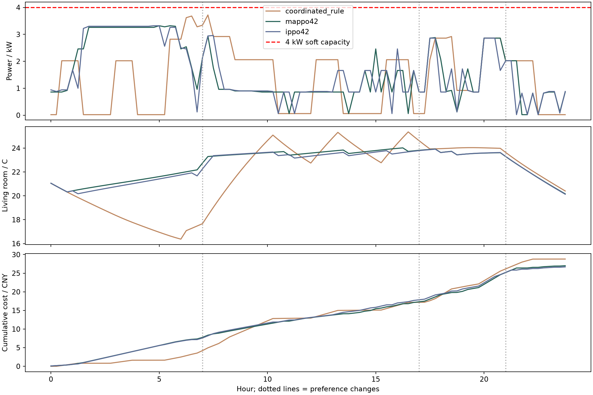
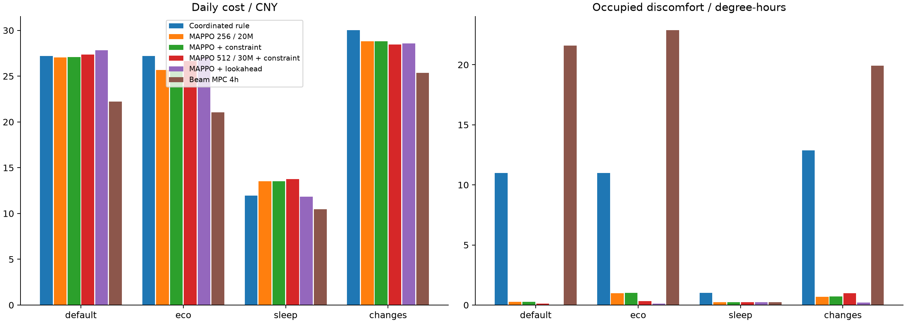
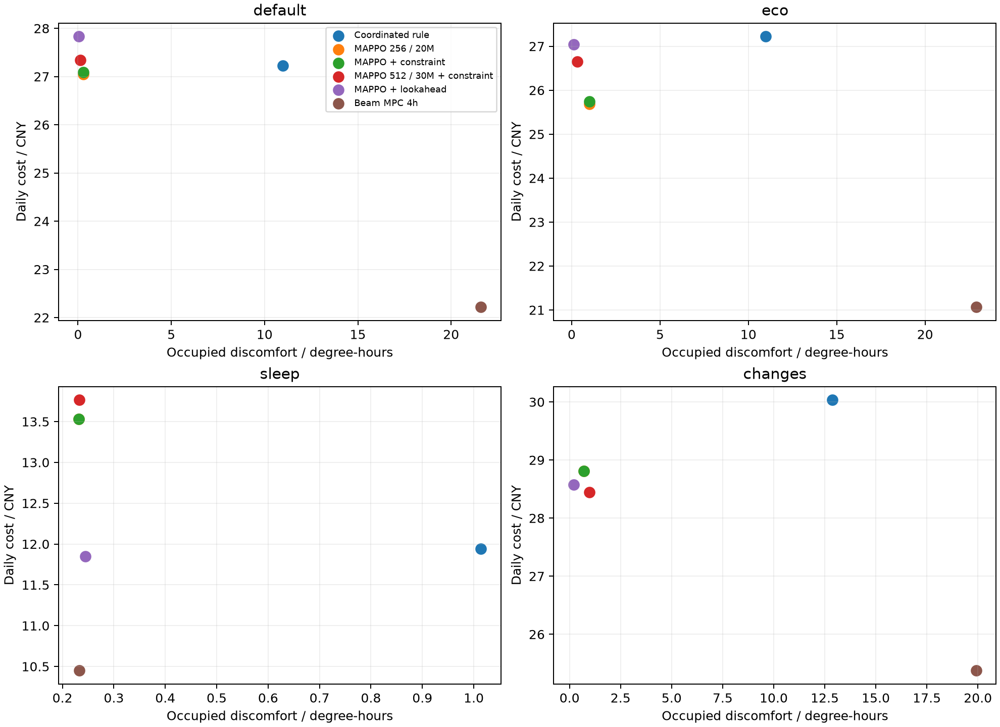

# 栖居：偏好条件化多智能体智能家居调控系统

## 摘要

本项目研究四个热区域共享用电容量时，如何依据动态生活偏好协调供暖和照明。系统将语言理解与设备控制分离：语音、文字和界面编辑更新目标，多智能体策略依据物理状态和目标选择动作。工程主线为 BenchMARL 1.5.2、TorchRL 0.11.1 和 GPU 原生批量 RC 热环境。相较早期方案，本次重构修正任务、观测、评估和部署链路，并加入参数化四区户型、持续语音入口与同步规则对照。

本报告不把旧环境上的失败归结为单一算法，也不预设节电幅度。除原始多种子MAPPO/IPPO对照外，第10节完整记录同预算模型扩容、联合功率分配、MPC与学习策略前瞻等探索，并区分探索日与冻结方案后的新日复验。扩大网络没有得到一致优势，短时域规划可能牺牲舒适，因而不能只展示收益最好的数字。所有指标来自实际评估产物；仿真结果不等于真实住宅节能。

冻结方案在20个新测试日、4种场景、6个控制器上完成480次整日仿真（46,080次环境转移）。连续改口场景中，MAPPO加8小时前瞻相对协调规则的日电费由30.033元降至28.578元（−4.85%），有人区域温度偏离由12.860降至0.212℃·h（−98.35%）；电费成对差的95%区间为[−1.983, −0.920]元。默认场景电费增加2.24%，且各场景耗电量均需单独考察，因此结论是显著改善舒适控制并在部分场景节费，而非普遍节电。正式复验完整八指标及所有探索数据见第11节和CSV附件。

**关键词：** 多智能体强化学习；MAPPO；偏好条件化；智能家居；模型前瞻；约束执行。

## 1. 问题定义与研究定位

四个固定功能区：客厅、卧室、厨房、浴室。每区独立选择供暖档位与照明档位，在共同电费、温度舒适度和 4 kW 软容量约束下合作。每步15分钟，一天96步，有限时域终止。

研究问题是偏好变化下的协同控制，而非训练一个识别“开灯”的语言模型。CityLearn提供建筑协调评测范式，home-llm提供语言控制工程参考；本项目将语义偏好作为控制策略条件。仅主张可运行、可比较的任务与系统集成，不主张首次提出语音+MARL。

旧方案存在目标与有效场景错位、无人舒适惩罚与离家目标冲突、协作瓶颈弱、训练和统计口径不统一等问题。旧代码和框架依赖已清理，压缩的历史指标在 `docs/history/historical_metrics.json`。不同环境版本之间不计算性能提升百分比。

## 2. 物理模型与户型

区域温度采用显式 Euler 离散：

$$
T_i^{t+1}=T_i^t+\frac{\Delta t}{C_i}\left[G_i(T_o^t-T_i^t)+COP\,P_{H,i}^t+\sum_j K_{ij}(T_j^t-T_i^t)\right].
$$

单位为小时、kW、kWh/℃。面积 A 在16–36㎡之间，`C_i=1.6 A_i/25`，`G_i=0.12 sqrt(A_i/25)`，`COP=3`。`K_ij=0.05 adjacency_ij`，对称连接、零对角，内部传热能量守恒。室外温度为9±4℃正弦加每回合±1℃偏移。固定日程加时间扰动、部分居家办公；天气和人员由测试种子确定。

供暖功率0/0.8/2 kW，照明功率0/0.02/0.06 kW。每房9个联合离散动作，所有控制器采用同一设备功率。峰价1.2、平价0.8、谷价0.4元/kWh。电量按功率×0.25小时计算，费用和电量分别统计。

户型编辑改变面积和对称传热门图，确实改变动力学。训练每回合随机面积和门图。当前界面以数据表编辑区域参数，不展示房屋图；热连接图不等同于真实墙体几何。房间数和功能仍固定，不支持任意房间数泛化。仅冬季供暖，无制冷、湿度、日照、设备启停延时或建筑参数辨识。

## 3. 偏好、观测、动作与奖励

偏好为14维：四房温度偏差[-3,3]、四房亮度{0,0.5,1}、省电权重[0,1]、五场景one-hot。睡眠只让卧室承担舒适目标，离家关闭舒适需求但保留安全温度惩罚，观影将客厅目标照明设暗，回家激活客厅。睡眠模板设卧室20℃，之后仍可修改。

每agent38维观测包含本区温度、实际目标误差、有效占用、下一小时占用、设备one-hot、照明目标、天气、电价及未来电价、时间、省电权重、场景、房间ID、六个全屋摘要，以及面积与四个传热连接。全屋摘要包括总功率、需求缺口、平均温度差、占用比例、容量与冷房数。分散执行时需要这些家庭聚合信号，不是完全无通信。

设 D 为有人房间超出目标±1℃部分的平均绝对温差，L 为有人房间照明不匹配比例，S 为低于12℃或高于30℃的平均超限温差，P 为总功率。原始团队奖励为：

$$
r=-2D-0.3L-(0.5+1.5w_{eco})\,cost-2\max(P-4,0)^2-2S.
$$

所有agent共享奖励。框架学习时乘0.2作固定数值缩放，评估仍报告原始奖励。无人房间不受舒适温差惩罚。容量与温度安全都是软惩罚，没有硬安全保证，不隐藏或裁剪学习动作。30%的训练家庭在第48步重采样偏好；测试连续指令在07:00、17:00、21:00更新偏好。

## 4. 算法与训练实现

主线实际调用 BenchMARL Experiment、TorchRL采样器、GAE和PPO损失，不是自写PPO冠以框架名称。MAPPO共享actor，以房间局部及公共观测输出9类动作概率；集中critic读取联合信息，训练时估计优势。部署仅使用actor，贪心选动作。

选择MAPPO的理由是合作任务适用、训练稳定的工程起点和统一框架支持。QMIX单调混合存在表示限制，但不能据此证明其在本任务必败。IPPO保持同样actor观测、网络规模、奖励、预算和采样设置，仅critic信息结构不同，以免将通信差异冒充算法差异。

| 项目 | 配置 |
|---|---|
| Actor / critic | 3×256 Tanh / 3×512 Tanh |
| 并行家庭 / rollout | 1024 / 96步 |
| 每批环境转移 | 98304，另有4个agent，二者不混淆 |
| PPO epochs / minibatch | 6 / 8192 |
| Adam / epsilon | 3e-4 / 1e-5 |
| gamma / GAE lambda | 0.99 / 0.95 |
| clipping / entropy / critic coefficient | 0.2 / 0.01 / 0.5 |
| gradient clipping | 0.5 |
| 训练预算 | 每次不少于20M环境转移，批量取整可能略超 |
| 主实验 | MAPPO种子42/43/44，IPPO种子42 |
| 验证 | seed900000，128并行家庭，按原始团队回报选择checkpoint |
| 测试 | seed100000–100019，每种偏好场景相同测试日 |

模型选择不使用测试集。IPPO目前一个训练种子，仅支持有限算法对照，不能据此宣称MAPPO显著胜出。已完成同预算网络容量对照；尚未执行通信、预测信息和奖励权重完整消融，不宣称当前结构最优。

GPU为本机报告49140 MiB的RTX4090。四组训练并行时实际采样GPU利用率100%、总显存16544MiB（`assets/evidence/gpu_snapshot.csv`）。单模型显存远小于48GB是控制任务规模决定的；利用GPU批量仿真和独立实验比无依据堆参数更有用。模型与环境版本强绑定，旧33维模型不能用于38维版本。

### 4.1 优化目标与执行边界

将任务表示为有限时域合作决策过程：状态包含四区温度、设备、天气、人员、时刻和偏好；每个智能体依据38维观测执行9类动作，最大化期望折扣团队回报。共享策略由房间ID和局部状态区分角色。MAPPO使用集中价值函数估计优势，PPO目标为：

$$L_{clip}=E[\min(\rho_t\hat A_t,\operatorname{clip}(\rho_t,1-\epsilon,1+\epsilon)\hat A_t)],\quad \rho_t=\pi_\theta(a_t|o_t)/\pi_{old}(a_t|o_t).$$

另加价值回归项与熵正则。集中critic只在训练使用，导出文件包含共享actor。纯actor的分散决策依赖全屋摘要广播；可行分配与前瞻模式额外需要集中执行器，不能将其收益全部归因于训练算法。

可行层仅在原联合动作不可行时，枚举9⁴种动作，最大化各agent logits之和并满足总功率约束。前瞻层保留可行策略首步照明，枚举3⁴种首步供暖组合，剔除不可行动作，再用同一热模型与可行MAPPO续接至32步。选择未折扣原奖励累计值最大的首步；无终端价值补偿，日末截断，下步重新求解。它改善执行决策，但依赖准确模型与已知日程，不能当作纯模型无关方法。

## 5. 对照协议

每个测试日固定天气、初温、人员、面积、传热门与偏好变化。默认、省电、睡眠、连续改口四个场景，分别运行：

- 占用感知恒温器：目标±1℃滞环、无人关灯、无价格意识。
- 协调规则：一小时占用预热、涨价前预热，枚举81种联合供暖档位，在同一容量约束下按需求分配。
- MAPPO三次独立训练和IPPO一次训练。

主指标为日电费、能量、有人区超温带累计degree-hours、有人区违规时长比例、峰功率、超容量kWh、照明不匹配和团队回报。舒适偏离同时体现幅度和时长，比“是否任一房违规”更可解释。低费用但舒适更差或超限增加不能直接称优势。

成对bootstrap2000次估计相对协调规则的测试日差异95%区间；训练种子均值和标准差另表报告。两种不确定性不能混用。图表展示所有结果，不抹去睡眠场景或IPPO的优势。动画固定选第一个测试日，不以最漂亮样例替代总体评估。

## 6. 实测结果

<!-- RESULTS -->
每个单元为20个固定测试日平均；所有测试均为当前v3物理模型。

| 场景 | 控制器 | 电费/元 | 舒适偏离/℃·h | 违规时间比例 | 超容量/kWh | 照明不符 |
|---|---|---:|---:|---:|---:|---:|
| default | thermostat | 23.853 | 25.375 | 51.36% | 1.0310 | 0.000 |
| default | coordinated_rule | 27.705 | 10.749 | 41.92% | 0.0000 | 0.000 |
| default | mappo42 | 27.278 | 0.185 | 3.22% | 0.0643 | 0.000 |
| default | mappo43 | 27.399 | 0.152 | 3.10% | 0.0050 | 0.000 |
| default | mappo44 | 27.129 | 0.220 | 4.21% | 0.0000 | 0.000 |
| default | ippo42 | 27.797 | 0.148 | 2.13% | 0.0000 | 0.000 |
| eco | thermostat | 23.853 | 25.375 | 51.36% | 1.0310 | 0.000 |
| eco | coordinated_rule | 27.705 | 10.749 | 41.92% | 0.0000 | 0.000 |
| eco | mappo42 | 26.133 | 0.736 | 10.15% | 0.0390 | 0.000 |
| eco | mappo43 | 26.583 | 0.381 | 5.26% | 0.0060 | 0.000 |
| eco | mappo44 | 26.266 | 0.734 | 8.35% | 0.0135 | 0.000 |
| eco | ippo42 | 26.606 | 0.355 | 6.04% | 0.0110 | 0.000 |
| sleep | thermostat | 12.136 | 1.295 | 21.41% | 0.0000 | 0.000 |
| sleep | coordinated_rule | 11.866 | 1.331 | 21.09% | 0.0000 | 0.000 |
| sleep | mappo42 | 13.263 | 0.204 | 1.77% | 0.0000 | 0.000 |
| sleep | mappo43 | 13.097 | 0.208 | 2.19% | 0.0000 | 0.000 |
| sleep | mappo44 | 11.753 | 0.207 | 2.14% | 0.0000 | 0.000 |
| sleep | ippo42 | 13.049 | 0.203 | 1.72% | 0.0000 | 0.000 |
| changes | thermostat | 28.028 | 20.469 | 39.20% | 1.2340 | 0.000 |
| changes | coordinated_rule | 29.710 | 12.999 | 34.77% | 0.0000 | 0.000 |
| changes | mappo42 | 28.701 | 0.647 | 4.79% | 0.0115 | 0.000 |
| changes | mappo43 | 29.053 | 0.504 | 3.73% | 0.0058 | 0.000 |
| changes | mappo44 | 28.106 | 0.629 | 3.96% | 0.0210 | 0.000 |
| changes | ippo42 | 29.034 | 0.490 | 4.37% | 0.0000 | 0.000 |

### MAPPO训练种子差异

| 场景 | 日电费：三种子均值±标准差 | 舒适偏离：均值±标准差 |
|---|---:|---:|
| default | 27.269 ± 0.135 | 0.186 ± 0.034 |
| eco | 26.328 ± 0.231 | 0.617 ± 0.204 |
| sleep | 12.704 ± 0.828 | 0.206 ± 0.002 |
| changes | 28.620 ± 0.478 | 0.594 ± 0.078 |

### 与协调规则的成对差异

以下为预先指定种子42，负数表示MAPPO更低；区间是测试日bootstrap，不代表训练种子置信区间。

| 场景 | 电费差 [95% CI] | 舒适偏离差 [95% CI] |
|---|---:|---:|
| default | -0.427 [-1.174, 0.322] | -10.563 [-12.066, -9.211] |
| eco | -1.572 [-2.240, -0.897] | -10.012 [-11.456, -8.711] |
| sleep | 1.397 [1.221, 1.607] | -1.127 [-1.483, -0.812] |
| changes | -1.009 [-1.628, -0.394] | -12.352 [-13.304, -11.488] |

### 结果解释

- default：MAPPO三种子平均费用相对协调规则降低1.58%，舒适偏离降低98.27%。
- eco：MAPPO三种子平均费用相对协调规则降低4.97%，舒适偏离降低94.26%。
- sleep：MAPPO三种子平均费用相对协调规则增加7.06%，舒适偏离降低84.50%。
- changes：MAPPO三种子平均费用相对协调规则降低3.67%，舒适偏离降低95.43%。

必须结合超容量和照明指标判断，不能将上述平均变化写成所有测试日保证。IPPO仅一个种子，不足以支持算法显著性排名。





### 训练资源

| 运行 | 环境转移 | 用时/秒 | 峰值torch分配/MiB |
|---|---:|---:|---:|
| mappo42 | 20054016 | 469.3 | 1853.9 |
| mappo43 | 20054016 | 466.4 | 1853.9 |
| mappo44 | 20054016 | 465.7 | 1853.9 |
| ippo42 | 20054016 | 478.2 | 5309.3 |
<!-- END_RESULTS -->

## 7. 系统与人机交互

界面主体为同条件数值对照表，逐项展示模型、规则、绝对差值和变化比例。四项固定 Canvas 曲线显示全屋功率、累计电费、四房温度及目标、累计舒适偏离；双缓冲更新保留画布节点，避免整图替换闪烁。房间明细可展开，意图透明面板呈现“识别文字→JSON→偏好”。界面不声称这些图能解释神经网络内部因果。

可编辑四区面积和传热门、逐房温度/亮度、全局省电偏好；默认自动推进，可暂停、倍速、跑完一天与重置。布局修改会同时重置双方，避免比较不同历史。每个浏览器会话拥有独立仿真状态。

持续语音采用浏览器SpeechRecognition，点击授权后持续接收最终识别结果并提交，支持关闭。浏览器识别可能依赖远程服务，需要HTTPS或localhost；不可用时明确提示并保留文本。可选OpenAI兼容本地LLM解析意图，非法JSON或服务失败走规则兜底。LLM无设备动作权限。

当前没有实机声学测试，也没有验证三套vLLM服务同时部署。自动化语音测试仅注入识别结果事件，以验证连续指令链路，不能算ASR准确率。当前主界面字幕确认，无已验证语音合成回播。更多执行器如窗帘、通风、插座需要动力学、动作和训练同步扩展，未用无物理作用的开关包装功能。

## 8. 验证与复现

运行命令与目录见根README。测试覆盖物理单位、传热守恒、面积影响、偏好有效性、同种子外生一致性、96步有限性、TorchRL接口、中文意图及双环境会话。导出一致性工具将实际BenchMARL策略和轻量部署actor在8个家庭96步上比较，共3072个agent动作，不允许推理网络悄然变化。

<!-- VALIDATION -->
发布验收：24项单元与集成测试通过（8条第三方弃用/未来兼容警告），见 `assets/evidence/tests.txt`。

实际框架导出动作一致性：见 `assets/evidence/export_check.txt`。

四条指令与一天回放：见 `assets/v2/scripted_trace.json`。

浏览器测试：{
  "passed": true,
  "javascript_errors": [],
  "checks": [
    "load",
    "stable canvas node across automatic updates",
    "named baseline switch resets paired day",
    "scene",
    "two continuous speech result events",
    "mic stop",
    "layout apply",
    "default automatic clock without click",
    "full day",
    "mobile screenshot"
  ],
  "limitation": "Speech events mocked; no microphone hardware or acoustic recognition tested."
}
<!-- END_VALIDATION -->

## 9. 局限与后续路线

优先增加IPPO多种子、同舒适阈值的成本曲线、参数范围外测试、更多季节与不确定人员预测。若引入部分可观测传感，再比较GRU或attention；当前不以更大模型作为先验答案。本轮已加入包含照明功率的集中可行分配层，保证当前仿真动作不超过约定容量；这不是实际设备安全认证。下一阶段可用Sinergym/EnergyPlus验证高保真效果，再连接真实Home Assistant设备。真实建筑参数辨识、舒适调查和声学噪声测试不可由当前仿真替代。

<!-- BEGIN_ARCHITECTURE_STUDY -->

## 10. 算法与架构优化：探索、消融与复验

本轮没有把扩大网络当作效果保证。完成了三组相同 30M 预算训练（256宽/seed42，512宽/seed42、43），以及联合约束执行、短时域 MPC、学习策略前瞻三类实验。主训练框架仍为实际 BenchMARL/TorchRL MAPPO。

### 冻结方案

四房共享 actor 提出动作；集中执行层枚举满足总功率的首步供暖组合，照明沿用学习策略；用同一 RC 模型向前模拟32步（8小时），后续动作由 MAPPO 决定，按原团队奖励累计值选择首步，然后下一时刻重新规划。不是单纯换规则，也不是纯分散执行 MAPPO，准确名称是“MAPPO + 基于模型的策略前瞻”。

容量可行性包括灯光功率。约束只保证本仿真当前动作的4kW可行性，不保证真实设备安全。未来天气/日程已知是假设；未来语音指令不进入前瞻。预测误差鲁棒性尚未验证。

### 实验协议

512宽复验展示的是两组扩容训练中验证回报较好的seed43，不能代表512宽的种子均值。先在验证日910000–910002比较1/2/4小时，再扩展8小时；按原团队回报选择。前期探索使用100000–100019。为避免反复看测试集，冻结8小时架构后，最终复验改用未参与探索的100020–100039，四种偏好场景，共80个场景日/控制器。不能称为预注册研究；仍需更多训练种子与外部环境验证。

下表为新的20日均值。温度偏离是有人区域超出目标±1℃后的度时，不等于不达标步数；低度时可能仍有频繁但轻微的越界。

|场景|控制器|电费/元|温度偏离/°C·h|不达标比例|超功率/kWh|
|---|---|---:|---:|---:|---:|
|default|coordinated_rule|27.222|10.978|41.7%|0.0000|
|default|mappo_original|27.051|0.279|3.6%|0.0265|
|default|mappo_feasible|27.087|0.282|3.7%|0.0000|
|default|mappo512|27.343|0.117|3.8%|0.0000|
|default|mappo_lookahead|27.831|0.037|3.9%|0.0000|
|default|mpc4h|22.218|21.599|41.0%|0.0000|
|eco|coordinated_rule|27.222|10.978|41.7%|0.0000|
|eco|mappo_original|25.687|0.998|10.6%|0.0705|
|eco|mappo_feasible|25.747|1.003|10.9%|0.0000|
|eco|mappo512|26.656|0.316|6.7%|0.0000|
|eco|mappo_lookahead|27.037|0.124|7.1%|0.0000|
|eco|mpc4h|21.066|22.884|42.3%|0.0000|
|sleep|coordinated_rule|11.944|1.014|19.2%|0.0000|
|sleep|mappo_original|13.530|0.232|2.2%|0.0000|
|sleep|mappo_feasible|13.530|0.232|2.2%|0.0000|
|sleep|mappo512|13.764|0.232|2.3%|0.0000|
|sleep|mappo_lookahead|11.851|0.245|3.9%|0.0000|
|sleep|mpc4h|10.450|0.233|2.8%|0.0000|
|changes|coordinated_rule|30.033|12.860|33.2%|0.0000|
|changes|mappo_original|28.814|0.690|4.4%|0.0115|
|changes|mappo_feasible|28.806|0.705|4.4%|0.0000|
|changes|mappo512|28.449|0.976|5.4%|0.0000|
|changes|mappo_lookahead|28.578|0.212|4.6%|0.0000|
|changes|mpc4h|25.375|19.913|28.0%|0.0000|

### 探索记录与发现

|问题|实验|观察|取舍|
|---|---|---|---|
|集中critic是否必需|同actor观测的MAPPO/IPPO，20M步|IPPO有竞争力，未证明MAPPO普遍占优|保留IPPO对照，不宣称集中critic优势|
|动作是否满足容量|原策略与联合可行分配，同模型同日|消除测试超功率，节费变化小|独立保留约束执行层|
|单用物理规划是否更好|1h/4h有限束宽MPC|部分场景费用低，但温度偏离更大|作为模型基线，不当作最优下界|
|规划多远合适|MAPPO续接的1/2/4h前瞻验证|1h回报−72.98，2h−44.18，4h−32.59|短时域拖延供暖，扩大时域|
|8h是否值得|额外8h验证，独立新日复验|验证回报−31.96优于4h；新日结果见上表|冻结8h，不用测试日选时域|
|更大网络是否更好|同30M预算256/512宽，512另一个种子|seed42扩容未胜出；不同种子有变化|不能把容量当作收益因果|
|效果如何呈现|真实策略与规则同步自动运行|同屏数值差值、功率、电费、舒适度可同时观察|避免只展示动作动画|

探索原始数字（测试日100000–100019，非最终确认集）：

|场景|控制器|电费/元|温度偏离/°C·h|
|---|---|---:|---:|
|default|coordinated_rule|27.705|10.749|
|default|mappo|27.278|0.185|
|default|mappo_feasible|27.293|0.197|
|default|mpc_1h|21.481|25.414|
|eco|coordinated_rule|27.705|10.749|
|eco|mappo|26.133|0.736|
|eco|mappo_feasible|26.164|0.760|
|eco|mpc_1h|20.595|26.952|
|sleep|coordinated_rule|11.866|1.331|
|sleep|mappo|13.263|0.204|
|sleep|mappo_feasible|13.263|0.204|
|sleep|mpc_1h|10.686|0.205|
|changes|coordinated_rule|29.710|12.999|
|changes|mappo|28.701|0.647|
|changes|mappo_feasible|28.685|0.653|
|changes|mpc_1h|24.732|21.989|
|default|mappo_lookahead|27.163|0.239|
|eco|mappo_lookahead|26.497|0.376|
|sleep|mappo_lookahead|11.559|0.238|
|changes|mappo_lookahead|28.576|1.400|

### 新方案相对协调规则

|场景|电费变化|温度偏离变化|电费差95%配对区间/元|
|---|---:|---:|---|
|default|+2.24%|-99.66%|[-0.169, 1.312]|
|eco|-0.68%|-98.87%|[-1.083, 0.637]|
|sleep|-0.78%|-75.85%|[-0.326, 0.109]|
|changes|-4.85%|-98.35%|[-1.983, -0.920]|

与原MAPPO比较（同权重，仅增加前瞻与可行执行）：

|场景|电费变化|温度偏离变化|
|---|---:|---:|
|default|+2.88%|-86.76%|
|eco|+5.25%|-87.57%|
|sleep|-12.41%|+5.72%|
|changes|-0.82%|-69.28%|

结论：前瞻不是原策略的全面替代。它主要改善默认/省电/改口的舒适控制，睡眠费用降低；默认/省电费用增加，睡眠温度偏离可能略增。保留raw/feasible/lookahead三种模式，不将权衡包装成单指标全面提升。

区间来自测试日配对bootstrap，不代表训练种子不确定性。MPC为有限束宽启发式，不是最优控制下界；部分场景省钱但舒适更差，不能只按电费排优劣。费用下降也不等于节电：峰谷移位可降低费用，却因供暖增加而提高总耗电。当前尚未完成严格的同舒适阈值成本曲线。

### 扩容消融（相同训练预算）

|训练|步数|最佳验证回报|选中步数|用时/秒|峰值torch显存/MiB|
|---|---:|---:|---:|---:|---:|
|mappo256_42|30081024|-30.615|26542080|562.1|1854|
|mappo512_42|30081024|-30.820|29491200|699.4|3042|
|mappo512_43|30081024|-30.566|27525120|700.4|3042|

同预算模型的探索日测试指标：

|场景|模型|电费/元|耗电/kWh|温度偏离/°C·h|
|---|---|---:|---:|---:|
|default|mappo256_42|27.542|40.992|0.067|
|eco|mappo256_42|26.630|39.683|0.421|
|sleep|mappo256_42|12.471|17.684|0.209|
|changes|mappo256_42|28.859|41.198|0.726|
|default|mappo512_42|26.998|40.273|0.192|
|default|mappo512_43|27.340|40.478|0.100|
|eco|mappo512_42|26.623|39.211|0.390|
|eco|mappo512_43|26.541|39.404|0.400|
|sleep|mappo512_42|12.879|18.890|0.205|
|sleep|mappo512_43|13.507|18.381|0.222|
|changes|mappo512_42|28.061|40.365|0.914|
|changes|mappo512_43|28.137|40.245|0.966|

同seed42时512宽的最佳验证回报没有胜过256宽；seed43较好并不足以证明容量因果收益。采用原256策略进行前瞻研究，是为了隔离执行架构变化。多任务并发训练已充分利用GPU计算，显存占用不是实验效果指标。

### 展示与边界

当前前端采用四房数据表与四项定量时序，默认自动推进，支持暂停/倍速、持续麦克风、温度与照明偏好、面积与热连通编辑。主表并列模型、规则、绝对差值与变化比例；房间明细可展开。固定Canvas双缓冲绘制四项曲线，避免逐步替换图片引起闪烁。可切换简单恒温器或协调规则并从同种子重跑，未人为调差规则参数；独立实验表仍采用协调规则。两者同步接收用户目标。累计电费与舒适偏离直接来自运行轨迹。一天结束循环测试日并保留最新用户偏好；这是演示循环，不是连续多日物理预测。

仍是四个固定功能区、16–36㎡/区的冬季供暖仿真；未接入真实住房。浏览器声学识别、本地语音服务部署及任意CAD导入未验收。

### 复现

```bash
python -m training.final_study
python -m training.optimization_report
python -m training.video
python demo/app.py --checkpoint results/layout/mappo42/best_actor.pt --controller lookahead --horizon 32 --port 7861
```

原始证据：`assets/final_study.json`（模型hash、逐日指标、逐步动作）；扩容对照：`assets/capacity_metrics.json`与`assets/capacity_control.json`；验证过程：`assets/lookahead_selection.json`与`assets/lookahead32_validation.json`。





### 执行开销

单住宅CPU、torch单线程，验证日连续24次决策去掉首步。本机测量，不是通用硬件承诺。

|控制器|中位/ms|P95/ms|
|---|---:|---:|
|rule|0.47|0.49|
|mappo|0.58|0.66|
|feasible|0.62|0.66|
|lookahead8h|73.61|78.04|
|mpc4h|9.97|10.06|
<!-- END_ARCHITECTURE_STUDY -->

<!-- PUBLICATION_TABLES -->
## 11. 完整指标附件与数据溯源

以下表格由 `python -m training.publication` 从已保存JSON直接生成，没有补造或手填实验数字。每行是20个测试日的算术均值；峰值列为每日峰值的均值，不是跨日最大值。违规率为各日“违规有人房间小时 / 有人房间小时”的均值，不是任一房间违规的整屋步数比例。

### 11.1 指标定义

|字段|定义与单位|方向|
|---|---|---|
|cost|Σ price(t) × power(t) × 0.25，元/日|低|
|energy_kwh|Σ power(t) × 0.25，kWh/日|低，须结合舒适|
|occupied_degree_hours|Σ 有人指示 × max(绝对温差−1,0) × 0.25，℃·h/日|低|
|occupied_violation_rate|Σ 有人且温差>1的房间小时 / Σ有人房间小时，无占用时为0|低|
|peak_kw|一天总功率最大值，kW|结合4kW容量|
|overload_kwh|Σ max(power−4,0) × 0.25，kWh/日|低|
|team_return|96步原始团队奖励之和；不含训练用0.2缩放|高|
|light_mismatch|96步有效占用房间照明不符比例的均值|低|

舒适度报告将房间度时求和，奖励则在每步对有效占用房间取平均，二者不是同一归一化。能量和电费相关但不能互换；低价时供暖增加可能改善舒适，却增加用电。

### 11.2 数据分层

|阶段|样本与用途|选择约束|
|---|---|---|
|训练|1024并行家庭，每回合随机物理参数、日程、偏好|训练分布内采样|
|权重验证|seed900000起128家庭，随机中途偏好|按验证回报选权重|
|时域验证|910000–910002，四场景|比较1/2/4小时，再扩展8小时|
|探索评估|100000–100019，四场景|用于发现问题，不作为最终独立确认|
|冻结后复验|100020–100039，四场景，六控制器|480次整日回放，同条件配对|

这些是同一模拟器分布的新种子，不能称跨建筑、跨季节外部分布验证。冻结方案仍源于此前探索，不声称预注册或反复试验后的无偏全流程统计检验。

### 11.3 冻结方案完整八指标

#### 费用、能量与舒适

|场景|控制器|电费/元|电量/kWh|偏离/℃·h|违规比例|
|---|---|---:|---:|---:|---:|
|default|coordinated_rule|27.2222|34.0750|10.9783|41.75%|
|default|mappo_original|27.0514|41.3800|0.2791|3.59%|
|default|mappo_feasible|27.0873|41.4000|0.2817|3.68%|
|default|mappo512|27.3426|40.8470|0.1167|3.79%|
|default|mappo_lookahead|27.8313|42.2710|0.0370|3.93%|
|default|mpc4h|22.2182|27.0850|21.5993|40.98%|
|eco|coordinated_rule|27.2222|34.0750|10.9783|41.75%|
|eco|mappo_original|25.6867|38.8795|0.9981|10.61%|
|eco|mappo_feasible|25.7473|38.8903|1.0031|10.92%|
|eco|mappo512|26.6556|39.7713|0.3158|6.68%|
|eco|mappo_lookahead|27.0365|40.8625|0.1240|7.11%|
|eco|mpc4h|21.0662|26.0050|22.8845|42.31%|
|sleep|coordinated_rule|11.9440|15.2250|1.0140|19.22%|
|sleep|mappo_original|13.5296|21.6727|0.2316|2.24%|
|sleep|mappo_feasible|13.5296|21.6727|0.2316|2.24%|
|sleep|mappo512|13.7643|18.6952|0.2325|2.34%|
|sleep|mappo_lookahead|11.8506|17.1572|0.2449|3.85%|
|sleep|mpc4h|10.4500|13.4600|0.2332|2.76%|
|changes|coordinated_rule|30.0333|35.8242|12.8603|33.25%|
|changes|mappo_original|28.8143|41.4638|0.6897|4.40%|
|changes|mappo_feasible|28.8060|41.4580|0.7053|4.40%|
|changes|mappo512|28.4487|40.6400|0.9759|5.40%|
|changes|mappo_lookahead|28.5775|41.8480|0.2119|4.58%|
|changes|mpc4h|25.3753|29.7642|19.9128|27.97%|

#### 容量、回报与照明

|场景|控制器|日峰均值/kW|超容量/kWh|团队回报|照明不符|
|---|---|---:|---:|---:|---:|
|default|coordinated_rule|4.0000|0.0000|-77.6871|0.0000|
|default|mappo_original|3.7790|0.0265|-31.8966|0.0000|
|default|mappo_feasible|3.5880|0.0000|-31.8521|0.0000|
|default|mappo512|3.6010|0.0000|-30.7435|0.0000|
|default|mappo_lookahead|3.7830|0.0000|-30.7995|0.0000|
|default|mpc4h|3.7740|0.0000|-126.5060|0.0000|
|eco|coordinated_rule|4.0000|0.0000|-98.1037|0.0000|
|eco|mappo_original|4.1320|0.0705|-53.9531|0.0000|
|eco|mappo_feasible|3.6530|0.0000|-53.8543|0.0000|
|eco|mappo512|3.6540|0.0000|-51.1426|0.0000|
|eco|mappo_lookahead|3.8650|0.0000|-50.5653|0.0000|
|eco|mpc4h|3.7650|0.0000|-147.2096|0.0000|
|sleep|coordinated_rule|2.1000|0.0000|-21.2501|0.0000|
|sleep|mappo_original|3.2800|0.0000|-16.7355|0.0000|
|sleep|mappo_feasible|3.2800|0.0000|-16.7355|0.0000|
|sleep|mappo512|2.1760|0.0000|-17.0005|0.0000|
|sleep|mappo_lookahead|3.1700|0.0000|-14.9969|0.0000|
|sleep|mpc4h|2.0600|0.0000|-13.3629|0.0000|
|changes|coordinated_rule|3.7860|0.0000|-96.5535|0.0000|
|changes|mappo_original|3.6370|0.0115|-41.0473|0.0000|
|changes|mappo_feasible|3.5640|0.0000|-41.1210|0.0000|
|changes|mappo512|3.3170|0.0000|-42.4596|0.0000|
|changes|mappo_lookahead|3.7280|0.0000|-37.1350|0.0000|
|changes|mpc4h|3.7860|0.0000|-122.6974|0.0000|

### 11.4 所有探索的机器可读附件

完整CSV包含 **108行场景/控制器汇总、2160行逐日记录**。不同研究复用相同测试日与基线，所以这些行不能当作独立样本数。

- [summary.csv](../assets/tables/summary.csv)：七组研究全部八指标。
- [daily.csv](../assets/tables/daily.csv)：逐日种子与原始指标，可重算配对差。
- [数据字典](../assets/tables/README.md)：文件、控制器名、统计口径。
- [证据清单](../assets/evidence/manifest.json)：数据及七个actor的SHA256。

发布权重是验证选中的actor，用于评估与演示；不含critic、优化器和采样器状态，因此不是可无缝续训的完整训练快照。完整训练可按配置从头复现，硬件/库版本变化可能产生数值差异。

<!-- END_PUBLICATION_TABLES -->

## 参考文献

1. Yu et al. The Surprising Effectiveness of PPO in Cooperative Multi-Agent Games. NeurIPS 2022. https://arxiv.org/abs/2103.01955
2. Rashid et al. QMIX: Monotonic Value Function Factorisation for Deep Multi-Agent Reinforcement Learning. ICML 2018. https://arxiv.org/abs/1803.11485
3. BenchMARL. https://github.com/facebookresearch/BenchMARL
4. TorchRL. https://pytorch.org/rl/
5. CityLearn. https://github.com/intelligent-environments-lab/CityLearn
6. Sinergym. https://github.com/ugr-sail/sinergym
7. home-llm. https://github.com/acon96/home-llm
8. Papoudakis et al. Benchmarking Multi-Agent Deep Reinforcement Learning Algorithms in Cooperative Tasks. NeurIPS Datasets and Benchmarks 2021. 历史框架背景，当前工程不依赖EPyMARL。
