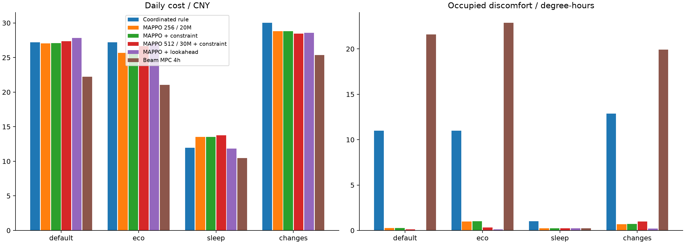
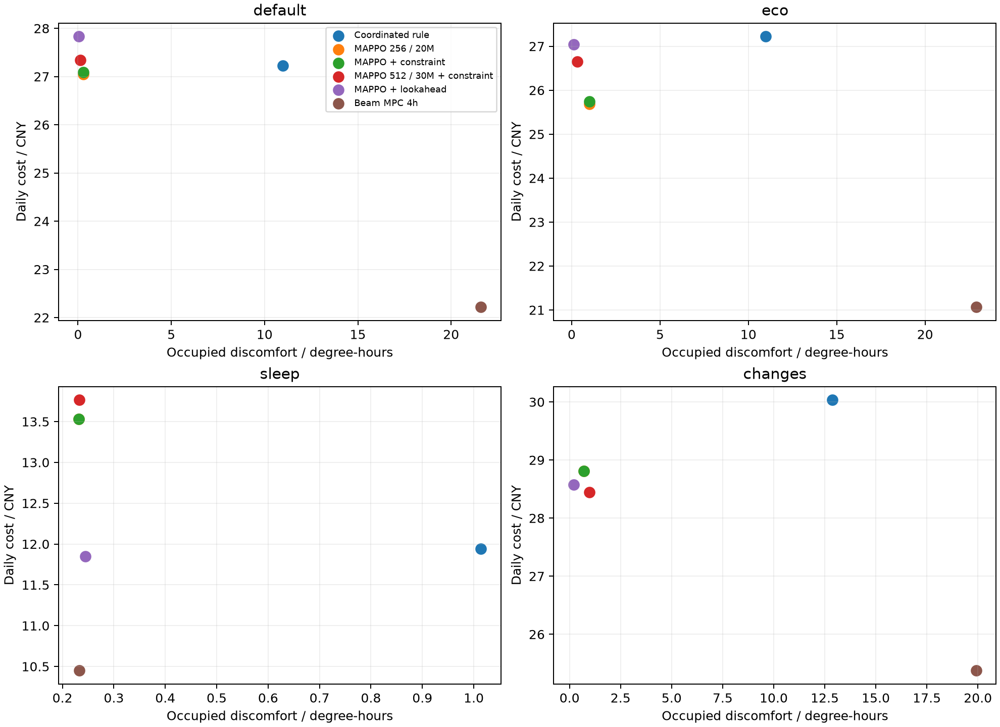

# 算法与架构优化复验

本轮没有把扩大网络当作效果保证。完成了三组相同 30M 预算训练（256宽/seed42，512宽/seed42、43），以及联合约束执行、短时域 MPC、学习策略前瞻三类实验。主训练框架仍为实际 BenchMARL/TorchRL MAPPO。

## 冻结方案

四房共享 actor 提出动作；集中执行层枚举满足总功率的首步供暖组合，照明沿用学习策略；用同一 RC 模型向前模拟32步（8小时），后续动作由 MAPPO 决定，按原团队奖励累计值选择首步，然后下一时刻重新规划。不是单纯换规则，也不是纯分散执行 MAPPO，准确名称是“MAPPO + 基于模型的策略前瞻”。

容量可行性包括灯光功率。约束只保证本仿真当前动作的4kW可行性，不保证真实设备安全。未来天气/日程已知是假设；未来语音指令不进入前瞻。预测误差鲁棒性尚未验证。

## 实验协议

512宽复验展示的是两组扩容训练中验证回报较好的seed43，不能代表512宽的种子均值。先在验证日910000–910002比较1/2/4小时，再扩展8小时；按原团队回报选择。前期探索使用100000–100019。为避免反复看测试集，冻结8小时架构后，最终复验改用未参与探索的100020–100039，四种偏好场景，共80个场景日/控制器。不能称为预注册研究；仍需更多训练种子与外部环境验证。

下表为新的20日均值。温度偏离是有人区域超出目标±1℃后的度时，不等于不达标步数；低度时可能仍有频繁但轻微的越界。

|场景|控制器|电费/元|温度偏离/°C·h|不达标比例|超功率/kWh|
|---|---|---:|---:|---:|---:|
|default|coordinated_rule|27.222|10.978|41.7%|0.0000|
|default|mappo_original|27.051|0.279|3.6%|0.0265|
|default|mappo_feasible|27.087|0.282|3.7%|0.0000|
|default|mappo512|27.343|0.117|3.8%|0.0000|
|default|mappo_lookahead|27.831|0.037|3.9%|0.0000|
|default|mpc4h|22.218|21.599|41.0%|0.0000|
|eco|coordinated_rule|27.222|10.978|41.7%|0.0000|
|eco|mappo_original|25.687|0.998|10.6%|0.0705|
|eco|mappo_feasible|25.747|1.003|10.9%|0.0000|
|eco|mappo512|26.656|0.316|6.7%|0.0000|
|eco|mappo_lookahead|27.037|0.124|7.1%|0.0000|
|eco|mpc4h|21.066|22.884|42.3%|0.0000|
|sleep|coordinated_rule|11.944|1.014|19.2%|0.0000|
|sleep|mappo_original|13.530|0.232|2.2%|0.0000|
|sleep|mappo_feasible|13.530|0.232|2.2%|0.0000|
|sleep|mappo512|13.764|0.232|2.3%|0.0000|
|sleep|mappo_lookahead|11.851|0.245|3.9%|0.0000|
|sleep|mpc4h|10.450|0.233|2.8%|0.0000|
|changes|coordinated_rule|30.033|12.860|33.2%|0.0000|
|changes|mappo_original|28.814|0.690|4.4%|0.0115|
|changes|mappo_feasible|28.806|0.705|4.4%|0.0000|
|changes|mappo512|28.449|0.976|5.4%|0.0000|
|changes|mappo_lookahead|28.578|0.212|4.6%|0.0000|
|changes|mpc4h|25.375|19.913|28.0%|0.0000|

## 探索记录与发现

|问题|实验|观察|取舍|
|---|---|---|---|
|集中critic是否必需|同actor观测的MAPPO/IPPO，20M步|IPPO有竞争力，未证明MAPPO普遍占优|保留IPPO对照，不宣称集中critic优势|
|动作是否满足容量|原策略与联合可行分配，同模型同日|消除测试超功率，节费变化小|独立保留约束执行层|
|单用物理规划是否更好|1h/4h有限束宽MPC|部分场景费用低，但温度偏离更大|作为模型基线，不当作最优下界|
|规划多远合适|MAPPO续接的1/2/4h前瞻验证|1h回报−72.98，2h−44.18，4h−32.59|短时域拖延供暖，扩大时域|
|8h是否值得|额外8h验证，独立新日复验|验证回报−31.96优于4h；新日结果见上表|冻结8h，不用测试日选时域|
|更大网络是否更好|同30M预算256/512宽，512另一个种子|seed42扩容未胜出；不同种子有变化|不能把容量当作收益因果|
|效果如何呈现|真实策略与规则同步自动运行|同屏数值差值、功率、电费、舒适度可同时观察|避免只展示动作动画|

探索原始数字（测试日100000–100019，非最终确认集）：

|场景|控制器|电费/元|温度偏离/°C·h|
|---|---|---:|---:|
|default|coordinated_rule|27.705|10.749|
|default|mappo|27.278|0.185|
|default|mappo_feasible|27.293|0.197|
|default|mpc_1h|21.481|25.414|
|eco|coordinated_rule|27.705|10.749|
|eco|mappo|26.133|0.736|
|eco|mappo_feasible|26.164|0.760|
|eco|mpc_1h|20.595|26.952|
|sleep|coordinated_rule|11.866|1.331|
|sleep|mappo|13.263|0.204|
|sleep|mappo_feasible|13.263|0.204|
|sleep|mpc_1h|10.686|0.205|
|changes|coordinated_rule|29.710|12.999|
|changes|mappo|28.701|0.647|
|changes|mappo_feasible|28.685|0.653|
|changes|mpc_1h|24.732|21.989|
|default|mappo_lookahead|27.163|0.239|
|eco|mappo_lookahead|26.497|0.376|
|sleep|mappo_lookahead|11.559|0.238|
|changes|mappo_lookahead|28.576|1.400|

## 新方案相对协调规则

|场景|电费变化|温度偏离变化|电费差95%配对区间/元|
|---|---:|---:|---|
|default|+2.24%|-99.66%|[-0.169, 1.312]|
|eco|-0.68%|-98.87%|[-1.083, 0.637]|
|sleep|-0.78%|-75.85%|[-0.326, 0.109]|
|changes|-4.85%|-98.35%|[-1.983, -0.920]|

与原MAPPO比较（同权重，仅增加前瞻与可行执行）：

|场景|电费变化|温度偏离变化|
|---|---:|---:|
|default|+2.88%|-86.76%|
|eco|+5.25%|-87.57%|
|sleep|-12.41%|+5.72%|
|changes|-0.82%|-69.28%|

结论：前瞻不是原策略的全面替代。它主要改善默认/省电/改口的舒适控制，睡眠费用降低；默认/省电费用增加，睡眠温度偏离可能略增。保留raw/feasible/lookahead三种模式，不将权衡包装成单指标全面提升。

区间来自测试日配对bootstrap，不代表训练种子不确定性。MPC为有限束宽启发式，不是最优控制下界；部分场景省钱但舒适更差，不能只按电费排优劣。费用下降也不等于节电：峰谷移位可降低费用，却因供暖增加而提高总耗电。当前尚未完成严格的同舒适阈值成本曲线。

## 扩容消融（相同训练预算）

|训练|步数|最佳验证回报|选中步数|用时/秒|峰值torch显存/MiB|
|---|---:|---:|---:|---:|---:|
|mappo256_42|30081024|-30.615|26542080|562.1|1854|
|mappo512_42|30081024|-30.820|29491200|699.4|3042|
|mappo512_43|30081024|-30.566|27525120|700.4|3042|

同预算模型的探索日测试指标：

|场景|模型|电费/元|耗电/kWh|温度偏离/°C·h|
|---|---|---:|---:|---:|
|default|mappo256_42|27.542|40.992|0.067|
|eco|mappo256_42|26.630|39.683|0.421|
|sleep|mappo256_42|12.471|17.684|0.209|
|changes|mappo256_42|28.859|41.198|0.726|
|default|mappo512_42|26.998|40.273|0.192|
|default|mappo512_43|27.340|40.478|0.100|
|eco|mappo512_42|26.623|39.211|0.390|
|eco|mappo512_43|26.541|39.404|0.400|
|sleep|mappo512_42|12.879|18.890|0.205|
|sleep|mappo512_43|13.507|18.381|0.222|
|changes|mappo512_42|28.061|40.365|0.914|
|changes|mappo512_43|28.137|40.245|0.966|

同seed42时512宽的最佳验证回报没有胜过256宽；seed43较好并不足以证明容量因果收益。采用原256策略进行前瞻研究，是为了隔离执行架构变化。多任务并发训练已充分利用GPU计算，显存占用不是实验效果指标。

## 展示与边界

当前前端采用四房数据表与四项定量时序，默认自动推进，支持暂停/倍速、持续麦克风、温度与照明偏好、面积与热连通编辑。主表并列模型、规则、绝对差值与变化比例；房间明细可展开。固定Canvas双缓冲绘制四项曲线，避免逐步替换图片引起闪烁。可切换简单恒温器或协调规则并从同种子重跑，未人为调差规则参数；独立实验表仍采用协调规则。两者同步接收用户目标。累计电费与舒适偏离直接来自运行轨迹。一天结束循环测试日并保留最新用户偏好；这是演示循环，不是连续多日物理预测。

仍是四个固定功能区、16–36㎡/区的冬季供暖仿真；未接入真实住房。浏览器声学识别、本地语音服务部署及任意CAD导入未验收。

## 复现

```bash
python -m training.final_study
python -m training.optimization_report
python -m training.video
python demo/app.py --checkpoint results/layout/mappo42/best_actor.pt --controller lookahead --horizon 32 --port 7861
```

原始证据：`assets/final_study.json`（模型hash、逐日指标、逐步动作）；扩容对照：`assets/capacity_metrics.json`与`assets/capacity_control.json`；验证过程：`assets/lookahead_selection.json`与`assets/lookahead32_validation.json`。





## 执行开销

单住宅CPU、torch单线程，验证日连续24次决策去掉首步。本机测量，不是通用硬件承诺。

|控制器|中位/ms|P95/ms|
|---|---:|---:|
|rule|0.47|0.49|
|mappo|0.58|0.66|
|feasible|0.62|0.66|
|lookahead8h|73.61|78.04|
|mpc4h|9.97|10.06|
