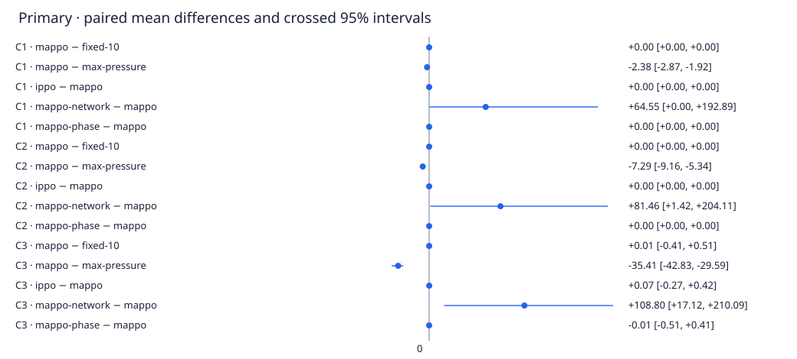

# 4×4 路网交通信号控制：实验结果

**任务**：16 个路口每 5 秒决定保持还是请求切换绿灯。比较学习策略能否在相同需求和切相约束下，降低道路内停车秒数/计划车辆数。主对照是独立验证集选出的固定时制和等权车辆数 Max Pressure。

## 主要结果

- **高需求下，局部奖励 MAPPO 比本项目的 Max Pressure 少 30.4%**：道路内停车指标由 116.41 降至 80.99 秒/车，低、中需求下也显著降低。
- **奖励消融：高需求下，局部奖励优于网络奖励**。改用网络奖励后，指标由 80.99 升至 189.80 秒/车。

下表列出全部 Holm 校正后 p < 0.05 的主比较。差值为左减右，单位秒/车，越低越好。p 值条件于实测训练种子，区间则同时重采样需求与训练初始化。

| 工况 | 对比 | 差值 | 交叉 bootstrap 95% 区间 | Holm p |
|---|---|---:|---:|---:|
| C1 | mappo − max-pressure | -2.38 | [-2.87, -1.92] | 0.0293 |
| C1 | mappo-network − mappo | +64.55 | [+0.00, +192.89] | 0.0293 |
| C2 | mappo − max-pressure | -7.29 | [-9.16, -5.34] | 0.0293 |
| C2 | mappo-network − mappo | +81.46 | [+1.42, +204.11] | 0.0293 |
| C3 | mappo − max-pressure | -35.41 | [-42.83, -29.59] | 0.0293 |
| C3 | mappo-network − mappo | +108.80 | [+17.12, +210.09] | 0.0293 |

这些结论限于表中对照，不能据此推断 MAPPO 优于所有控制方法或学出了路口协同。低需求的奖励对比区间仍包含零。

## 实验范围与完整性

完整性校验通过：1200 个训练 episode，1260 个评估 episode，20160 条局部指标，600 个主测试评估通过逐动作 checkpoint 贪婪回放。评估分组：{'budget': 150, 'ood': 180, 'test': 840, 'validation': 90}；后端：libsumo。

这是受前期预试启发的探索性实验，主比较和独立需求在汇总测试结果前冻结。训练/验证/测试/分布外使用互斥的需求种子；训练轮次 24 与 60 同轨迹存档，不按测试表现挑选权重。固定周期只在独立验证集选择。

附录：完整对照、消融结果与机制审计

局部奖励 MAPPO 相对验证集选出的固定时制没有显著改进。低、中需求下，IPPO 和 MAPPO 的逐秒轨迹与固定时制一致（每档、每种方法各 50/50 次）。集中 critic 和 actor 交通观测也未显示显著增益。

## 1. 主测试：固定周期扫参和三项消融

主指标为 600 秒观察窗中道路内停车车辆秒数 ÷ 计划车辆数，越小越好；不含入网等待。每格为按初始化平均后、10 个需求种子的均值 ± 样本标准差。带 * 的固定周期由验证集选出，测试扫参仅作描述。

| 方法 | C1 | C2 | C3 |
|---|---:|---:|---:|
| fixed-10 | 10.05 ± 0.82 * | 24.82 ± 1.80 * | 80.98 ± 5.37 * |
| fixed-15 | 18.56 ± 0.98 | 36.36 ± 2.19 | 132.75 ± 12.37 |
| fixed-20 | 25.54 ± 2.00 | 46.08 ± 2.67 | 136.15 ± 6.72 |
| fixed-30 | 28.89 ± 2.20 | 55.33 ± 3.71 | 175.44 ± 13.31 |
| fixed-45 | 40.02 ± 2.76 | 70.36 ± 4.79 | 196.19 ± 15.27 |
| fixed-60 | 52.89 ± 3.88 | 79.96 ± 3.31 | 208.31 ± 12.03 |
| max-pressure | 12.43 ± 0.99 | 32.11 ± 2.76 | 116.41 ± 11.39 |
| hold | 330.60 ± 7.37 | 336.21 ± 3.75 | 355.96 ± 2.98 |
| ippo | 10.05 ± 0.82 | 24.82 ± 1.80 | 81.06 ± 5.23 |
| mappo | 10.05 ± 0.82 | 24.82 ± 1.80 | 80.99 ± 5.15 |
| mappo-network | 74.60 ± 2.29 | 106.28 ± 5.39 | 189.80 ± 5.54 |
| mappo-phase | 10.05 ± 0.82 | 24.82 ± 1.80 | 80.98 ± 5.37 |

## 2. 主比较：成对差值

负差值表示左侧方法等待更少。固定初始化条件下的 bootstrap 仅重采样需求；交叉 bootstrap 独立重采样初始化与需求，同一对比内保持配对。两个区间均为百分位 95% 区间，验证时制选择视为固定。少量初始化或需求下区间不稳定。

| 工况 | 比较 | 差值 | 条件区间 | 交叉区间 | 需求数 | Holm p |
|---|---|---:|---:|---:|---:|---:|
| C1 | mappo − fixed-10 | +0.00 | [+0.00, +0.00] | [+0.00, +0.00] | 10 | 1.0000 |
| C1 | mappo − max-pressure | -2.38 | [-2.87, -1.92] | [-2.87, -1.92] | 10 | 0.0293 |
| C1 | ippo − mappo | +0.00 | [+0.00, +0.00] | [+0.00, +0.00] | 10 | 1.0000 |
| C1 | mappo-network − mappo | +64.55 | [+63.56, +65.61] | [+0.00, +192.89] | 10 | 0.0293 |
| C1 | mappo-phase − mappo | +0.00 | [+0.00, +0.00] | [+0.00, +0.00] | 10 | 1.0000 |
| C2 | mappo − fixed-10 | +0.00 | [+0.00, +0.00] | [+0.00, +0.00] | 10 | 1.0000 |
| C2 | mappo − max-pressure | -7.29 | [-9.16, -5.34] | [-9.16, -5.34] | 10 | 0.0293 |
| C2 | ippo − mappo | +0.00 | [+0.00, +0.00] | [+0.00, +0.00] | 10 | 1.0000 |
| C2 | mappo-network − mappo | +81.46 | [+78.83, +83.98] | [+1.42, +204.11] | 10 | 0.0293 |
| C2 | mappo-phase − mappo | +0.00 | [+0.00, +0.00] | [+0.00, +0.00] | 10 | 1.0000 |
| C3 | mappo − fixed-10 | +0.01 | [-0.33, +0.35] | [-0.41, +0.51] | 10 | 1.0000 |
| C3 | mappo − max-pressure | -35.41 | [-42.87, -29.56] | [-42.83, -29.59] | 10 | 0.0293 |
| C3 | ippo − mappo | +0.07 | [-0.19, +0.31] | [-0.27, +0.42] | 10 | 1.0000 |
| C3 | mappo-network − mappo | +108.80 | [+104.93, +113.03] | [+17.12, +210.09] | 10 | 0.0293 |
| C3 | mappo-phase − mappo | -0.01 | [-0.35, +0.33] | [-0.51, +0.41] | 10 | 1.0000 |

Holm 校正只应用于 15 个主比较。精确符号翻转检验在固定初始化集合上对需求配对差做检验，依赖零假设下差值的符号可交换性，不是跨训练种子显著性检验。

## 3. 训练预算：60 轮减 24 轮

负差值表示左侧方法等待更少。固定初始化条件下的 bootstrap 仅重采样需求；交叉 bootstrap 独立重采样初始化与需求，同一对比内保持配对。两个区间均为百分位 95% 区间，验证时制选择视为固定。少量初始化或需求下区间不稳定。

| 工况 | 比较 | 差值 | 条件区间 | 交叉区间 | 需求数 | Holm p |
|---|---|---:|---:|---:|---:|---:|
| C1 | ippo@60 − ippo@24 | +0.00 | [+0.00, +0.00] | [+0.00, +0.00] | 5 | — |
| C1 | mappo@60 − mappo@24 | +0.00 | [+0.00, +0.00] | [+0.00, +0.00] | 5 | — |
| C2 | ippo@60 − ippo@24 | +0.00 | [+0.00, +0.00] | [+0.00, +0.00] | 5 | — |
| C2 | mappo@60 − mappo@24 | +0.00 | [+0.00, +0.00] | [+0.00, +0.00] | 5 | — |
| C3 | ippo@60 − ippo@24 | -0.09 | [-0.26, +0.04] | [-0.60, +0.31] | 5 | — |
| C3 | mappo@60 − mappo@24 | -0.38 | [-1.22, +0.26] | [-1.76, +0.71] | 5 | — |

预算切片只用每档前五个测试需求；不能据此断言收敛。

## 4. 分布外压力：冻结策略

负差值表示左侧方法等待更少。固定初始化条件下的 bootstrap 仅重采样需求；交叉 bootstrap 独立重采样初始化与需求，同一对比内保持配对。两个区间均为百分位 95% 区间，验证时制选择视为固定。少量初始化或需求下区间不稳定。

| 工况 | 比较 | 差值 | 条件区间 | 交叉区间 | 需求数 | Holm p |
|---|---|---:|---:|---:|---:|---:|
| burst | ippo − fixed-10 | +0.00 | [+0.00, +0.00] | [+0.00, +0.00] | 5 | — |
| burst | ippo − max-pressure | -8.40 | [-10.91, -6.64] | [-10.91, -6.64] | 5 | — |
| burst | mappo − fixed-10 | +0.00 | [+0.00, +0.00] | [+0.00, +0.00] | 5 | — |
| burst | mappo − max-pressure | -8.40 | [-10.91, -6.64] | [-10.91, -6.64] | 5 | — |
| hotspot | ippo − fixed-10 | +1.87 | [+0.08, +4.97] | [+0.00, +6.15] | 5 | — |
| hotspot | ippo − max-pressure | -31.63 | [-47.21, -19.56] | [-47.21, -19.34] | 5 | — |
| hotspot | mappo − fixed-10 | +0.94 | [-0.43, +2.96] | [-0.50, +3.31] | 5 | — |
| hotspot | mappo − max-pressure | -32.57 | [-48.37, -20.39] | [-48.40, -20.21] | 5 | — |
| sustained | ippo − fixed-10 | +0.00 | [+0.00, +0.00] | [+0.00, +0.00] | 5 | — |
| sustained | ippo − max-pressure | -10.63 | [-12.39, -8.96] | [-12.38, -8.96] | 5 | — |
| sustained | mappo − fixed-10 | +0.00 | [+0.00, +0.00] | [+0.00, +0.00] | 5 | — |
| sustained | mappo − max-pressure | -10.63 | [-12.39, -8.96] | [-12.38, -8.96] | 5 | — |

脉冲：同规模车辆更集中地出发；热点：按经过 C2 的边加权重采样完整路线；持续：延长注入和观察窗。三者不是同一强度轴，各工况与本工况的固定时制和 Max Pressure 比较。

| 工况 | 方法 | 主指标 | 完成率 | 未入网数 | 切相次数 |
|---|---|---:|---:|---:|---:|
| burst | fixed-10 | 33.43 | 100.0% | 0.0 | 944.0 |
| burst | max-pressure | 41.84 | 100.0% | 0.0 | 434.4 |
| burst | ippo | 33.43 | 100.0% | 0.0 | 944.0 |
| burst | mappo | 33.43 | 100.0% | 0.0 | 944.0 |
| hotspot | fixed-10 | 89.31 | 60.9% | 13.0 | 944.0 |
| hotspot | max-pressure | 122.81 | 62.8% | 2.6 | 449.2 |
| hotspot | ippo | 91.18 | 60.5% | 12.4 | 942.3 |
| hotspot | mappo | 90.24 | 60.8% | 13.5 | 942.4 |
| sustained | fixed-10 | 33.31 | 100.0% | 0.0 | 1424.0 |
| sustained | max-pressure | 43.93 | 100.0% | 0.0 | 831.6 |
| sustained | ippo | 33.31 | 100.0% | 0.0 | 1424.0 |
| sustained | mappo | 33.31 | 100.0% | 0.0 | 1424.0 |

## 5. 机制审计：是反应式控制还是快速轮转？

| 工况 | 方法 | 与固定 10 秒完全一致（逐秒轨迹和全部流量指标） | 实际切相均值 | 清零交通特征动作翻转率 | 跨路口置换动作翻转率 | 平均策略熵 |
|---|---|---:|---:|---:|---:|---:|
| C1 | ippo | 50/50 | 944.0 | 0.00% | 0.00% | 0.268 |
| C1 | mappo | 50/50 | 944.0 | 0.00% | 0.00% | 0.352 |
| C1 | mappo-network | 29/50 | 753.4 | 0.25% | 0.45% | 0.680 |
| C1 | mappo-phase | 50/50 | 944.0 | 0.00% | 0.00% | 0.325 |
| C2 | ippo | 50/50 | 944.0 | 0.00% | 0.00% | 0.268 |
| C2 | mappo | 50/50 | 944.0 | 0.00% | 0.00% | 0.351 |
| C2 | mappo-network | 13/50 | 712.0 | 4.66% | 5.58% | 0.681 |
| C2 | mappo-phase | 50/50 | 944.0 | 0.00% | 0.00% | 0.325 |
| C3 | ippo | 36/50 | 942.7 | 0.26% | 0.45% | 0.285 |
| C3 | mappo | 27/50 | 943.0 | 0.32% | 0.60% | 0.360 |
| C3 | mappo-network | 8/50 | 608.7 | 16.37% | 11.73% | 0.682 |
| C3 | mappo-phase | 50/50 | 944.0 | 0.00% | 0.00% | 0.325 |

动作翻转是封闭回路轨迹上的离线反事实，不是部署后的闭环收益；清零/跨路口置换可能产生训练外输入。`mappo-phase` 只屏蔽 actor 流量字段，critic 仍看完整全局观测。匹配数不代表未见场景上的全局策略等价。

各学习方法的跨初始化样本标准差（每个初始化先对 10 个需求求均值）：

| 方法 | C1 | C2 | C3 |
|---|---:|---:|---:|
| ippo | 0.00 | 0.00 | 0.16 |
| mappo | 0.00 | 0.00 | 0.27 |
| mappo-network | 143.11 | 134.02 | 121.84 |
| mappo-phase | 0.00 | 0.00 | 0.00 |

## 6. 容量、切相与局部代价

| 工况 | 方法 | 完成率 | 未入网车辆 | 未完成车辆 | 完成样本等待（秒） | 停车加待插入（秒/计划车辆） | 最坏路口队列积分 | 切相次数 |
|---|---|---:|---:|---:|---:|---:|---:|---:|
| C1 | fixed-10 | 100.0% | 0.0 | 0.0 | 10.0 | 10.3 | 306.1 | 944.0 |
| C1 | max-pressure | 100.0% | 0.0 | 0.0 | 12.4 | 12.7 | 426.2 | 351.9 |
| C1 | hold | 19.0% | 0.0 | 243.1 | 0.9 | 330.8 | 9681.2 | 0.0 |
| C1 | ippo | 100.0% | 0.0 | 0.0 | 10.0 | 10.3 | 306.1 | 944.0 |
| C1 | mappo | 100.0% | 0.0 | 0.0 | 10.0 | 10.3 | 306.1 | 944.0 |
| C1 | mappo-network | 83.7% | 0.0 | 49.0 | 8.3 | 74.8 | 2298.8 | 753.4 |
| C1 | mappo-phase | 100.0% | 0.0 | 0.0 | 10.0 | 10.3 | 306.1 | 944.0 |
| C2 | fixed-10 | 100.0% | 0.0 | 0.0 | 24.8 | 25.3 | 1674.6 | 944.0 |
| C2 | max-pressure | 100.0% | 0.0 | 0.0 | 32.1 | 32.6 | 2429.4 | 462.0 |
| C2 | hold | 17.7% | 0.4 | 493.7 | 3.2 | 336.7 | 16886.7 | 0.0 |
| C2 | ippo | 100.0% | 0.0 | 0.0 | 24.8 | 25.3 | 1674.6 | 944.0 |
| C2 | mappo | 100.0% | 0.0 | 0.0 | 24.8 | 25.3 | 1674.6 | 944.0 |
| C2 | mappo-network | 77.3% | 0.1 | 136.4 | 20.1 | 106.8 | 8129.6 | 712.0 |
| C2 | mappo-phase | 100.0% | 0.0 | 0.0 | 24.8 | 25.3 | 1674.6 | 944.0 |
| C3 | fixed-10 | 75.6% | 0.0 | 293.0 | 70.8 | 82.2 | 8207.0 | 944.0 |
| C3 | max-pressure | 70.8% | 0.0 | 350.7 | 92.0 | 117.6 | 13776.1 | 606.4 |
| C3 | hold | 9.7% | 42.2 | 1084.1 | 15.2 | 368.8 | 30462.4 | 0.0 |
| C3 | ippo | 75.6% | 0.0 | 292.8 | 70.9 | 82.3 | 8149.4 | 942.7 |
| C3 | mappo | 75.6% | 0.0 | 292.7 | 70.9 | 82.2 | 8189.7 | 943.0 |
| C3 | mappo-network | 47.9% | 14.2 | 624.7 | 56.0 | 195.0 | 20106.7 | 608.7 |
| C3 | mappo-phase | 75.6% | 0.0 | 293.0 | 70.8 | 82.2 | 8207.0 | 944.0 |

C3 中相对验证选时制的平均局部队列代价（探索性，选最大/最小值不做显著性判断）：

| 方法 | 平均变差路口数 | 增量最大路口 | 增量最小路口 |
|---|---:|---|---|
| ippo | 8/16 | B2 / +124 车秒 | B3 / -59 车秒 |
| mappo | 8/16 | B2 / +118 车秒 | B4 / -131 车秒 |
| mappo-network | 16/16 | D1 / +8698 车秒 | C3 / +5829 车秒 |
| mappo-phase | 0/16 | B1 / +0 车秒 | B1 / +0 车秒 |

主测试最大等待的学习策略复现点：C3 / mappo-network / 初始化 55 / 需求 2006；主指标 361.18，完成 95/1200，全网切相 0 次。完成样本等待可能低估积压策略的代价。‘停车加待插入’把观察窗内两个逐秒车数相加再除以计划车辆数，仅作敏感性描述，不替代主指标或完整旅行时间。
所有评估中有 0/1260 个 episode 的‘入网 − 完成 − 末秒在网车辆’非零。该差额不是 teleport 事件数；SUMO-RL 1.4.5 默认 `time_to_teleport=-1`（关闭堵塞超时传送）。未记录全部 teleport 生命周期，即使差额为零也不能排除其他原因导致的传送。

## 7. 数据与复现

- `tables/episodes.csv`：完整评估矩阵；`intersections.csv`：队列积分、切相；`summary.csv`：各指标与跨需求标准差；`initializations.csv`：训练种子级均值；`contrasts.csv`：差值和区间；`local_contrasts.csv`：局部配对描述；`actions.csv`：机制审计；`training.csv`：PPO 诊断。
- `figures/`：固定时制、置信区间、训练诊断、种子分布、最坏场景轨迹、C3 路口热图。
- 原始评估、逐秒与动作轨迹、SUMO tripinfo 和 checkpoint 由实验命令重建，不收入 Git。
- `inputs.json` 记录原始路网与需求哈希；`selection.json` 记录验证选时制。

仅一个合成网格、两个许可绿灯相位；未测试事故、通信受限、真实车流、多路网或真实信号安全约束。共享参数 PPO 与集中 critic 实现是受 IPPO/MAPPO 启发的简化版本，不是论文完整实现。结论限于冻结预算和测试工况；未做等效性检验，不能把区间覆盖零解释为等效。
