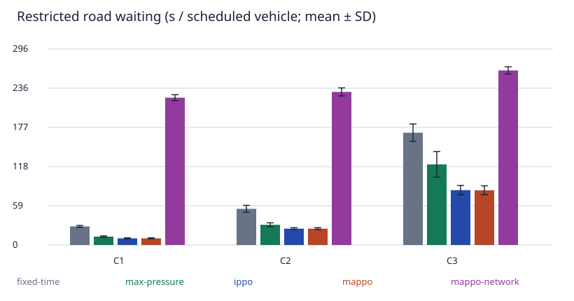
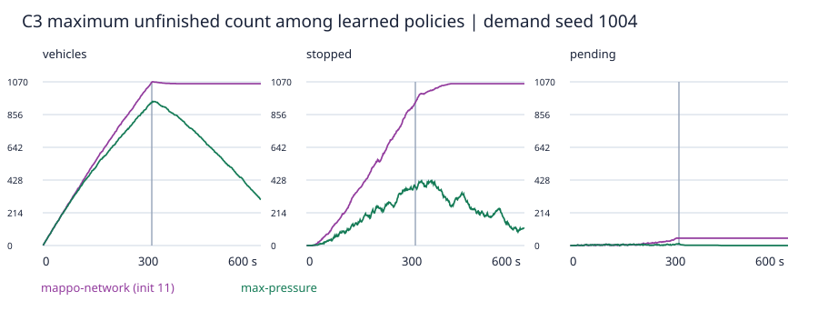
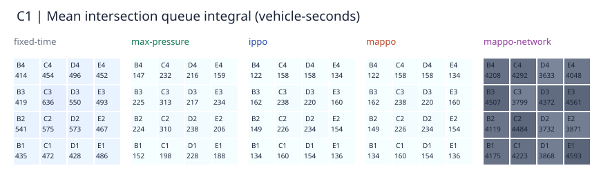
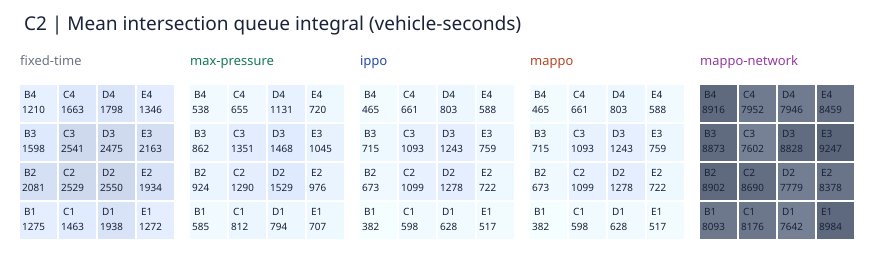
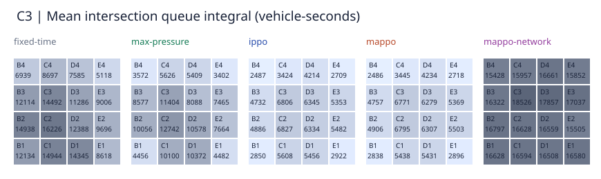
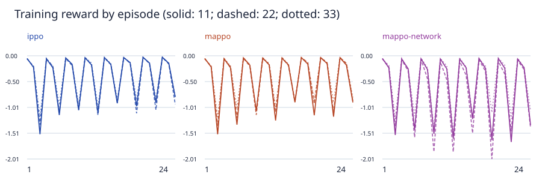

# 正式评估：结果表与图

已核验 330 个评估 episode，覆盖三个档位、每档 10 个配对需求；学习方法每个需求先平均三个独立初始化。

主指标为仿真窗口内的全网停止车秒 / 计划发车数（秒/车，越低越好）；未插入车辆的等待不计入。完成车辆的等待与行程指标有条件抽样偏差，须同时查看滞留和未插入。表格为需求均值 ± 样本标准差。

| 档位 | 方法 | 主指标 | 完成车辆 | 未完成车辆 | 未插入车辆 |
|---|---|---:|---:|---:|---:|
| C1 | fixed-time | 28.03 ± 1.47 | 300.00 ± 0.00 | 0.00 ± 0.00 | 0.00 ± 0.00 |
| C1 | max-pressure | 12.71 ± 1.01 | 300.00 ± 0.00 | 0.00 ± 0.00 | 0.00 ± 0.00 |
| C1 | ippo | 10.06 ± 0.74 | 300.00 ± 0.00 | 0.00 ± 0.00 | 0.00 ± 0.00 |
| C1 | mappo | 10.06 ± 0.74 | 300.00 ± 0.00 | 0.00 ± 0.00 | 0.00 ± 0.00 |
| C1 | mappo-network | 222.19 ± 4.46 | 138.67 ± 3.31 | 161.33 ± 3.31 | 0.00 ± 0.00 |
| C2 | fixed-time | 54.54 ± 5.24 | 599.00 ± 1.83 | 1.00 ± 1.83 | 0.00 ± 0.00 |
| C2 | max-pressure | 30.46 ± 2.99 | 599.90 ± 0.32 | 0.10 ± 0.32 | 0.00 ± 0.00 |
| C2 | ippo | 24.68 ± 1.47 | 599.90 ± 0.32 | 0.10 ± 0.32 | 0.00 ± 0.00 |
| C2 | mappo | 24.68 ± 1.47 | 599.90 ± 0.32 | 0.10 ± 0.32 | 0.00 ± 0.00 |
| C2 | mappo-network | 230.87 ± 6.09 | 272.23 ± 9.53 | 327.77 ± 9.53 | 0.47 ± 0.55 |
| C3 | fixed-time | 169.39 ± 13.11 | 716.20 ± 68.79 | 483.80 ± 68.79 | 0.70 ± 1.34 |
| C3 | max-pressure | 121.61 ± 19.34 | 822.80 ± 97.29 | 377.20 ± 97.29 | 0.00 ± 0.00 |
| C3 | ippo | 82.75 ± 7.11 | 898.63 ± 68.43 | 301.37 ± 68.43 | 0.00 ± 0.00 |
| C3 | mappo | 82.53 ± 6.67 | 901.53 ± 66.93 | 298.47 ± 66.93 | 0.00 ± 0.00 |
| C3 | mappo-network | 263.30 ± 5.42 | 380.13 ± 26.23 | 819.87 ± 26.23 | 30.47 ± 4.26 |

## 运营与局部指标

吞吐量为 600 s 全窗口完成数折算为辆/小时，不代表稳态容量。最坏路口按每个 episode 的最大进口排队积分（车秒）汇总。

| 档位 | 方法 | 完成车等待 s | 完成车旅行 s | 吞吐量 | 平均网络停车数 | 平均在网数 | 最坏路口车秒 | 切相次数 |
|---|---|---:|---:|---:|---:|---:|---:|---:|
| C1 | fixed-time | 27.99 ± 1.47 | 137.80 ± 3.52 | 1800.00 ± 0.00 | 14.02 ± 0.74 | 68.90 ± 1.76 | 847.50 ± 165.07 | 304.00 ± 0.00 |
| C1 | max-pressure | 12.68 ± 1.02 | 118.80 ± 3.08 | 1800.00 ± 0.00 | 6.35 ± 0.51 | 59.40 ± 1.54 | 369.10 ± 21.89 | 349.30 ± 8.79 |
| C1 | ippo | 10.04 ± 0.74 | 120.77 ± 3.04 | 1800.00 ± 0.00 | 5.03 ± 0.37 | 60.39 ± 1.52 | 287.20 ± 33.61 | 944.00 ± 0.00 |
| C1 | mappo | 10.04 ± 0.74 | 120.77 ± 3.04 | 1800.00 ± 0.00 | 5.03 ± 0.37 | 60.39 ± 1.52 | 287.20 ± 33.61 | 944.00 ± 0.00 |
| C1 | mappo-network | 3.88 ± 0.48 | 105.95 ± 4.87 | 832.00 ± 19.87 | 111.10 ± 2.23 | 147.32 ± 1.92 | 6330.60 ± 604.76 | 314.67 ± 0.00 |
| C2 | fixed-time | 54.36 ± 5.11 | 177.93 ± 7.46 | 3594.00 ± 10.95 | 54.54 ± 5.24 | 178.18 ± 7.72 | 3582.30 ± 731.74 | 304.00 ± 0.00 |
| C2 | max-pressure | 30.42 ± 2.98 | 151.15 ± 5.39 | 3599.40 ± 1.90 | 30.46 ± 2.99 | 151.17 ± 5.44 | 1996.40 ± 521.11 | 465.00 ± 22.98 |
| C2 | ippo | 24.64 ± 1.45 | 151.25 ± 4.94 | 3599.40 ± 1.90 | 24.68 ± 1.47 | 151.28 ± 4.98 | 1684.70 ± 468.88 | 944.00 ± 0.00 |
| C2 | mappo | 24.64 ± 1.45 | 151.25 ± 4.94 | 3599.40 ± 1.90 | 24.68 ± 1.47 | 151.28 ± 4.98 | 1684.70 ± 468.88 | 944.00 ± 0.00 |
| C2 | mappo-network | 10.22 ± 0.98 | 119.29 ± 4.81 | 1633.40 ± 57.18 | 230.87 ± 6.09 | 307.70 ± 5.97 | 11534.83 ± 475.04 | 314.67 ± 0.00 |
| C3 | fixed-time | 114.01 ± 5.90 | 256.39 ± 8.38 | 4297.20 ± 412.73 | 338.77 ± 26.23 | 629.12 ± 17.28 | 19741.50 ± 2025.76 | 304.00 ± 0.00 |
| C3 | max-pressure | 89.76 ± 3.78 | 250.84 ± 6.82 | 4936.80 ± 583.77 | 243.23 ± 38.68 | 589.83 ± 24.14 | 16647.60 ± 6585.44 | 594.40 ± 35.29 |
| C3 | ippo | 70.75 ± 3.21 | 250.78 ± 5.87 | 5391.80 ± 410.58 | 165.50 ± 14.21 | 566.05 ± 15.98 | 9303.03 ± 2515.67 | 943.53 ± 0.74 |
| C3 | mappo | 70.94 ± 2.98 | 251.09 ± 5.55 | 5409.20 ± 401.57 | 165.06 ± 13.33 | 565.80 ± 15.83 | 9122.67 ± 2187.33 | 943.23 ± 0.59 |
| C3 | mappo-network | 34.24 ± 3.58 | 157.43 ± 4.95 | 2280.80 ± 157.39 | 526.60 ± 10.85 | 718.64 ± 10.37 | 21740.80 ± 1571.66 | 314.47 ± 0.36 |

## 配对差值与消融

差值 = 方法 − 参照；负值表示主指标下降。按需求 seed 成对重采样 10000 次（统计 seed 20261122），区间不覆盖训练种子总体的不确定性，也不作为多重显著性检验。

| 档位 | 方法 | 参照 | 平均差值 | 95% CI |
|---|---|---|---:|---:|
| C1 | ippo | fixed-time | -17.97 | [-18.72, -17.26] |
| C1 | ippo | max-pressure | -2.65 | [-3.16, -2.25] |
| C1 | mappo | fixed-time | -17.97 | [-18.72, -17.26] |
| C1 | mappo | max-pressure | -2.65 | [-3.16, -2.25] |
| C1 | mappo-network | fixed-time | +194.16 | [+191.84, +196.42] |
| C1 | mappo-network | max-pressure | +209.49 | [+207.03, +212.06] |
| C1 | max-pressure | fixed-time | -15.32 | [-15.98, -14.74] |
| C1 | ippo | mappo | +0.00 | [+0.00, +0.00] |
| C1 | mappo-network | mappo | +212.14 | [+209.67, +214.73] |
| C2 | ippo | fixed-time | -29.87 | [-32.22, -27.60] |
| C2 | ippo | max-pressure | -5.78 | [-6.89, -4.59] |
| C2 | mappo | fixed-time | -29.87 | [-32.22, -27.60] |
| C2 | mappo | max-pressure | -5.78 | [-6.89, -4.59] |
| C2 | mappo-network | fixed-time | +176.33 | [+173.79, +179.18] |
| C2 | mappo-network | max-pressure | +200.41 | [+197.37, +203.61] |
| C2 | max-pressure | fixed-time | -24.08 | [-26.06, -22.26] |
| C2 | ippo | mappo | +0.00 | [+0.00, +0.00] |
| C2 | mappo-network | mappo | +206.20 | [+203.05, +209.44] |
| C3 | ippo | fixed-time | -86.64 | [-92.29, -80.91] |
| C3 | ippo | max-pressure | -38.87 | [-48.30, -30.43] |
| C3 | mappo | fixed-time | -86.85 | [-92.38, -81.28] |
| C3 | mappo | max-pressure | -39.08 | [-48.30, -30.91] |
| C3 | mappo-network | fixed-time | +93.91 | [+88.40, +99.61] |
| C3 | mappo-network | max-pressure | +141.69 | [+131.54, +150.84] |
| C3 | max-pressure | fixed-time | -47.77 | [-55.86, -40.33] |
| C3 | ippo | mappo | +0.22 | [-0.13, +0.79] |
| C3 | mappo-network | mappo | +180.77 | [+177.71, +183.83] |

## 失效与局部退化

- C3 fixed-time 最大积压：需求 1000、初始化 None，未完成 596/1200，期末仍在网 594、未插入 2。
- C3 max-pressure 最大积压：需求 1000、初始化 None，未完成 557/1200，期末仍在网 557、未插入 0。
- C3 ippo 最大积压：需求 1005、初始化 11，未完成 380/1200，期末仍在网 380、未插入 0。
- C3 mappo 最大积压：需求 1005、初始化 11，未完成 380/1200，期末仍在网 380、未插入 0。
- C3 mappo-network 最大积压：需求 1004、初始化 11，未完成 1106/1200，期末仍在网 1058、未插入 48。

下图选取学习方法中未完成数最多的一次运行，与同一需求的 Max Pressure 对照；竖线为停止注入的时刻。这是按积压挑选的极端案例，不代表典型需求。

- C1 学习方法相对 Max Pressure 的最大路口排队积分差：mappo-network / E1，+4404.5 车秒。

- C2 学习方法相对 Max Pressure 的最大路口排队积分差：mappo-network / B4，+8377.8 车秒。

- C3 学习方法相对 Max Pressure 的最大路口排队积分差：mappo-network / E4，+12449.6 车秒。

## 训练曲线

连续各 episode 使用不同档位和需求；曲线仅用于诊断，不支持收敛或性能结论。

完整数据、逐初始化结果和配对统计见 `tables/`。
